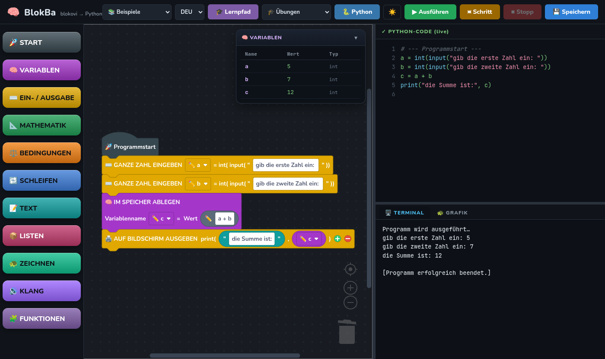
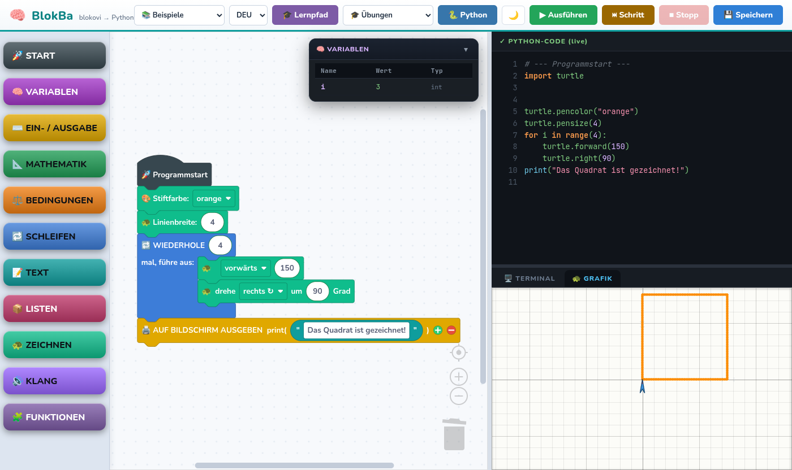
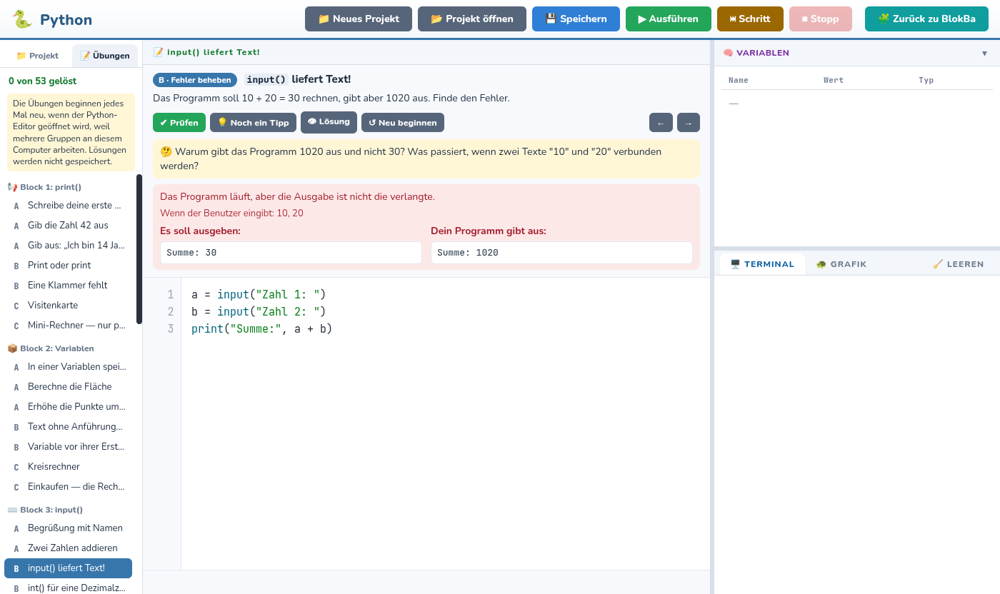

# BlokBa

**Vom ersten Block zum echten Python-Programm — in einer Anwendung.**

BlokBa ist eine kostenlose Anwendung für den Programmierunterricht in der
Grundschule und Sekundarstufe I. Die Schülerinnen und Schüler setzen Blöcke
zusammen, und die Blöcke werden **live in echten Python-Code übersetzt**, der
sofort ausgeführt wird. Wenn es Zeit für textbasiertes Programmieren ist,
bleiben sie in derselben Anwendung: dasselbe Fenster, dasselbe Terminal,
derselbe Helfer — nur schreiben sie den Code jetzt selbst.

Funktioniert **vollständig offline**, unter Windows und Linux, auch auf älteren
Rechnern.

> [Bosanski](README.md) · [Hrvatski](README.hr.md) · [English](README.en.md) · **Deutsch**



---

## Download

Neueste Version: **[BlokBa 2.2.2](../../releases/latest)**

| System | Download | Hinweis |
|---|---|---|
| Windows 10/11 | **[BlokBa-2.2.2-Setup.exe](https://github.com/DinoIsanovic/BlokBa-app/releases/latest/download/BlokBa-2.2.2-Setup.exe)** | Empfohlen — einmal installieren |
| Windows 10/11 | [BlokBa-2.2.2-portable.exe](https://github.com/DinoIsanovic/BlokBa-app/releases/latest/download/BlokBa-2.2.2-portable.exe) | Ohne Installation, z. B. vom USB-Stick |
| Linux (64-bit) | **[BlokBa-2.2.2.AppImage](https://github.com/DinoIsanovic/BlokBa-app/releases/latest/download/BlokBa-2.2.2.AppImage)** | Eine Datei, ohne Installation |
| Linux (Debian/Ubuntu) | [BlokBa_2.2.2_amd64.deb](https://github.com/DinoIsanovic/BlokBa-app/releases/latest/download/BlokBa_2.2.2_amd64.deb) | Standard-.deb-Paket |

Hinweise zum ersten Start stehen [weiter unten](#erster-start).

---

## Vom Block zum Code

In den meisten blockbasierten Werkzeugen ist der Block eine Metapher: Ein
Befehl wie `sage [Hallo]` hat nichts damit zu tun, wie man das in einer echten
Sprache schreibt. In BlokBa zeigt der Block die **tatsächliche
Python-Syntax**:

    ⌨ GANZE ZAHL EINGEBEN  [x]  = int( input( "Zahl eingeben: " ))

```python
x = int(input("Zahl eingeben: "))
```

Klammern, Anführungszeichen und `int()` sind keine Verzierung — das ist der
Code, der ausgeführt wird. Der Weg zum textbasierten Programmieren führt
deshalb über drei Stufen, ohne das Werkzeug zu wechseln:

| Stufe | Was die Lernenden tun |
|---|---|
| 🧩 **Stecken** | Blöcke ziehen und zusehen, wie daneben Zeile für Zeile Python-Code entsteht. |
| ✏️ **Tippen** | Einen Ausdruck direkt in ein Feld des Blocks tippen (`x + a`, `n % 2 == 0`), statt ihn aus kleineren Blöcken zu bauen. |
| 🐍 **Code schreiben** | Das ganze Programm im Python-Editor selbst schreiben. Ein Programm aus Blöcken öffnet sich im Editor als Code, und Code lässt sich wieder in Blöcke umwandeln. |

---

## Was BlokBa bietet

### 🧩 Blöcke, die Python sind
- 11 Kategorien: Variablen, Ein- und Ausgabe, Mathematik, Bedingungen,
  Schleifen, Text, Listen, Zeichnen, Ton, Funktionen und Start
- Der Python-Code entsteht live neben den Blöcken
- Der Variablenname wird mit dem Stift direkt in den Block geschrieben — die
  Variable entsteht automatisch
- Die Bedingung in WENN- und SOLANGE-Blöcken ist ein echter Block: herausziehen,
  austauschen oder eintippen



### 🤖 Geführte Einführung
**10 Lektionen** Schritt für Schritt — von der ersten Bildschirmausgabe bis zu
Schleifen und Bedingungen. Der Roboter BoT zeigt, wo geklickt wird, und prüft
jeden Schritt. Am Ende jeder Lektion steht eine **eigenständige Aufgabe**.

### 🐍 Python-Editor
- Programme werden als gewöhnliche `.py`-Dateien im eigenen Ordner gespeichert
- **Jede Zeile wird schon beim Tippen geprüft** — ein Fehler wird sofort
  markiert, nicht erst beim Ausführen
- Der Editor hält die Einrückung nach `if`, `for`, `while` und `def`
- Alles wird automatisch gespeichert, mit früheren Versionen zum Zurückgehen

### ✅ Python-Übungen mit Prüfung
Die Übungen sind für das **Schreiben von echtem Python-Code** gedacht. Sie
werden im Python-Editor gelöst: Schaltfläche **🐍 Python**, dann Reiter
**📝 Übungen**. Es sind **53**, geordnet nach dem Stoff, und jede prüft sich
selbst.

| Bereich | Übungen | Was geübt wird |
|---|:---:|---|
| Block 1: `print()` | 7 | Text und Zahlen ausgeben, Text und Zahl verbinden, Groß- und Kleinschreibung, Klammern |
| Block 2: Variablen | 7 | Werte speichern, mit Variablen rechnen, Fläche, Einkaufsrechnung |
| Block 3: `input()` | 6 | Eingabe über die Tastatur, `int()` und `float()`, warum `input()` Text liefert |
| Block 4: `if` / `elif` / `else` | 9 | Bedingungen, Doppelpunkt und Einrückung, `=` und `==`, Schutz vor Division durch null |
| Block 5: `for`-Schleife | 24 | Zählen, Countdown, Summe und Produkt, Einmaleins, gerade Zahlen, Buchstabe für Buchstabe, die größte von fünf Zahlen |

#### Arten von Übungen

- **Lücke füllen** (21 Übungen). Das Programm ist fertig bis auf eine oder
  mehrere mit Unterstrichen (`___`) markierte Stellen. Die Lernenden befassen sich nur mit dem neuen
  Befehl; der Rest des Programms dient als Beispiel. Z. B. *Das Einmaleins
  mit 7*, *`elif` — drei Möglichkeiten*.
- **Fehler beheben** (16 Übungen). Das Programm funktioniert nicht oder
  rechnet falsch. Es sind Fehler, die Anfängerinnen und Anfänger wirklich
  machen: `Print` statt `print`, ein fehlender Doppelpunkt oder eine fehlende
  Einrückung, `=` statt `==`, eine Variable, die benutzt wird, bevor es sie
  gibt, `input()`, das Text liefert, sodass `10 + 20` `1020` ergibt, eine
  Summe, die in der Schleife jedes Mal auf null zurückgesetzt wird.
- **Programm schreiben** (15 Übungen). Es gibt nur eine Beschreibung; das
  Programm schreiben die Lernenden selbst. Z. B. *Temperaturumrechner*,
  *Durchschnitt von drei Noten*, *Rechner mit Prüfung der Division*, *Wie
  viele a?*, *Die größte von fünf*. Der Wortlaut der Ausgabe ist frei;
  geprüft wird, ob die Ergebnisse stimmen.
- **Zeilen ordnen** (1 Übung). Die Zeilen eines richtigen Programms sind
  gemischt und ohne Einrückung. Getippt wird nichts: Die Zeilen werden
  verschoben und eingerückt, denn in Python gehört die Einrückung zum
  Programm. Diese Art ist an zweidimensionale Parsons-Aufgaben angelehnt.

#### So läuft die Prüfung

- **✔ Prüfen** führt das Programm mit festgelegten Eingaben aus — wo nötig
  mehrmals mit verschiedenen Zahlen — und vergleicht die Ausgabe mit der
  Ausgabe der Lösung.
- Stimmt die Ausgabe nicht, sehen die Lernenden, mit welchen Eingaben das
  Programm lief, und nebeneinander, **was ausgegeben werden sollte** und
  **was das Programm ausgegeben hat**.
- Stürzt das Programm ab, erklärt der Roboter den Fehler in einfacher
  Sprache; darunter steht klein die originale Python-Meldung, damit man sich
  daran gewöhnt, sie zu lesen.
- **💡 Tipp** kommt in zwei Schritten: zuerst eine Frage, die auf die Spur
  führt, dann ein konkreter Hinweis zu dieser Übung.
- Neben der Erklärung des Roboters steht ein Hinweis zu genau diesem Fehler
  in dieser Übung, z. B. was zu tun ist, wenn `int()`
  eine Dezimalzahl bekommt.
- **👁 Lösung** zeigt die Lösung, **↺ Neu beginnen** setzt die Übung zurück, und
  die Pfeile führen zur vorherigen und nächsten Übung.
- **▶ Ausführen** und **Schritt** funktionieren auch in der Übung, mit der
  Variablentabelle.
- Die Übungen gibt es in allen Sprachen der Oberfläche. Neben dem
  Aufgabentext ist auch der Code selbst übersetzt: Ausgabetexte und
  Variablennamen.
- Die Übungen beginnen jedes Mal von vorn, wenn der Python-Editor geöffnet
  wird, weil mehrere Gruppen am selben Computer arbeiten.



#### Im Unterricht

- Die Bereiche folgen der Reihenfolge des Stoffs, sodass die Übungen eines
  Bereichs direkt nach dem jeweiligen Thema gegeben werden können.
- Jede Übung ist kurz und in sich abgeschlossen und passt auch in einen Teil
  einer Stunde.
- Eine Übung beginnt und endet im selben Fenster, in dem das Programm
  geschrieben und ausgeführt wird, ohne Wechsel in ein anderes Programm.
- Am Beamer kann das Programm einer Übung Schritt für Schritt ausgeführt
  werden, mit der Variablentabelle.

### 👀 Sehen, was das Programm tut
- **Die Variablentabelle** ändert sich live während der Ausführung, mit
  Datentyp
- **Schritt für Schritt:** Das Programm läuft Zeile für Zeile, die aktuelle
  Zeile ist hervorgehoben
- **Die Schildkröte** zeichnet auf einem Koordinatengitter; **Ton** spielt Noten
- Ein- und Ausgabe laufen über ein Terminal, wie in echtem Python

### 💬 Hilfe, wenn das Programm abstürzt
Der Roboter-Assistent übersetzt Python-Fehlermeldungen in einfache Sprache: was
passiert ist, in welcher Zeile und wie man es behebt. Er erkennt auch
Endlosschleifen. Funktioniert **ohne Internet** und ohne Einrichtung. Auf
Wunsch lässt sich zusätzlich ein echter KI-Helfer einschalten — siehe
[BoT mit einem KI-Modell](#bot-mit-einem-ki-modell).

### 🌍 Sprachen
Oberfläche auf **Bosnisch** (lateinisch und kyrillisch), **Kroatisch**,
**Englisch** und **Deutsch**. Einführung und Übungen sind übersetzt.

---

## Einsatz im Unterricht

**Klassenzimmer ohne Internet und ältere Rechner.** BlokBa braucht nichts aus
dem Netz. Die Windows-Version bringt ihr eigenes Python mit, auf den
Schulrechnern muss außer der Anwendung selbst nichts installiert werden.

**Ein Werkzeug von Klasse 6 bis 9.** Die Lernenden beginnen mit Blöcken,
tippen dann Ausdrücke in Blockfelder und wechseln schließlich in den
Python-Editor. Die Umgebung bleibt dieselbe — es geht keine Zeit für die
Einarbeitung in ein neues Programm verloren.

**Am Beamer.** Code neben den Blöcken, Schritt-für-Schritt-Ausführung und die
Variablentabelle zeigen, was im Programm während der Ausführung passiert — was
der Rechner in jeder Zeile tut und wie sich Werte ändern.

**Selbstständiges Arbeiten.** Die geführte Einführung erklärt die Anwendung,
ohne dass die Lehrkraft jeden Klick erklären muss. Übungen prüfen sich selbst
und der Roboter erklärt Fehler — die Lehrkraft bleibt frei für die
Lernenden, die wirklich Hilfe brauchen.

**Jede und jeder im eigenen Ordner.** Die Dialoge zum Öffnen und Speichern
beginnen in `Dokumente`, wo die Lernenden ihre eigenen Ordner haben (z. B.
`6aG1`, `6aG2`). Programme bleiben dort.

**Arbeiten zu Hause.** Die Anwendung ist kostenlos und funktioniert zu Hause
genauso wie in der Schule. Ein Programm lässt sich als `.py`-Datei exportieren
und in jeder Python-Umgebung öffnen.

---

## Erster Start

### Windows

Beim ersten Start zeigt Windows möglicherweise ein blaues Fenster: **„Der
Computer wurde durch Windows geschützt"**. Das ist kein Virus — die Meldung
erscheint bei jedem Programm, das nicht digital signiert ist. Auf **Weitere
Informationen** klicken, dann auf **Trotzdem ausführen**.

Python wird **nicht benötigt** — es ist im Programm enthalten. Ist auf dem
Rechner bereits Python installiert, verwendet BlokBa dieses.

### Linux

Das AppImage braucht die Berechtigung zum Ausführen: Rechtsklick →
*Eigenschaften* → *Zugriffsrechte* → *Ausführbar*, oder im Terminal:

```bash
chmod +x BlokBa-2.2.2.AppImage
./BlokBa-2.2.2.AppImage
```

Unter Debian und Ubuntu kann stattdessen das `.deb`-Paket installiert werden:

```bash
sudo dpkg -i BlokBa_2.2.2_amd64.deb
```

Benötigt wird **Python 3.10 oder neuer**. Die meisten Distributionen bringen es
mit; falls nicht, meldet BlokBa das und zeigt den Installationsbefehl an.

---

## BoT mit einem KI-Modell

Zusätzlich zur Hilfe, die immer offline funktioniert, kann BoT mit einem
echten Sprachmodell verbunden werden. Dann können die Lernenden in eigenen
Worten fragen — bei den Blöcken und im Python-Editor. BoT sieht das Programm
und kennt die vorhandenen Blöcke, **löst die Aufgabe aber nicht anstelle der
Lernenden**: Er führt mit Fragen, Schritt für Schritt.

| Dienst | Erforderlich |
|---|---|
| Anthropic (Claude) | API-Schlüssel, Internet |
| OpenAI (GPT) | API-Schlüssel, Internet |
| Google (Gemini) | API-Schlüssel, Internet |
| **Ollama** | lokal installiertes Modell, **ohne Internet** |

Einzurichten im Menü **KI-Assistent → API-Schlüssel setzen**. Der Schlüssel
bleibt nur auf diesem Rechner. Der KI-Helfer bleibt **ausgeschaltet, bis er
aktiviert wird.**

**Vor dem Einschalten:**
- **Kosten.** Anthropic, OpenAI und Google rechnen die Nutzung über das eigene
  Konto ab; Google bietet ein kostenloses Kontingent zum Ausprobieren.
- **Datenschutz.** Bei Online-Diensten werden Fragen und Code der Lernenden an
  den Anbieter übertragen. Das verdient eine bewusste Entscheidung im Einklang
  mit den Richtlinien der Schule. **Ollama behält alles auf dem Rechner.**
- **Ollama braucht einen leistungsfähigen Rechner** — mehrere Gigabyte
  Arbeitsspeicher, idealerweise auf der Grafikkarte. Auf älteren
  Schulrechnern bleibt die Offline-Hilfe.

---

## Fehler melden und Vorschläge

<!-- LINK: hier Link zum Discord-Kanal einfügen -->

Bitte **immer die Versionsnummer angeben** (*Hilfe → Über BlokBa*) sowie das
Betriebssystem. Ohne diese Angaben lässt sich nicht feststellen, ob der Fehler
bereits behoben ist.

Ein Screenshot hilft mehr als eine Beschreibung.

---

## Das Projekt unterstützen

BlokBa ist kostenlos und bleibt es. Wer die weitere Arbeit unterstützen möchte:

Paypal: nodi_bih@yahoo.de

---

## Nutzungsbedingungen

BlokBa darf **kostenlos genutzt und in unveränderter Form weitergegeben**
werden — in der Schule und zu Hause.

Das Verändern, Umpacken und Verbreiten veränderter Versionen ist nicht
gestattet.

---

## Autoren

Dino Isanović · Jasmin Suljkanović · Elvir Čajić
