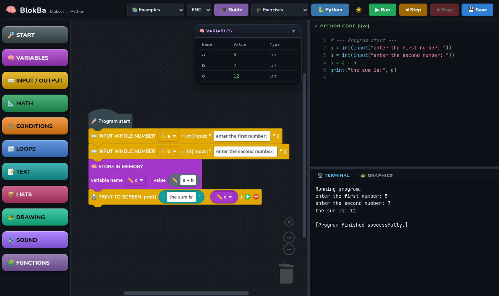
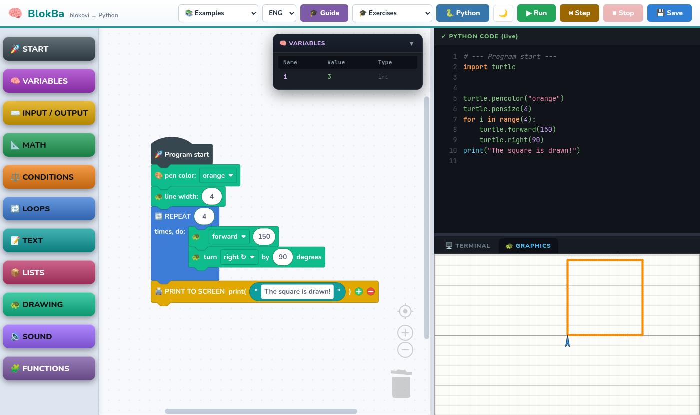
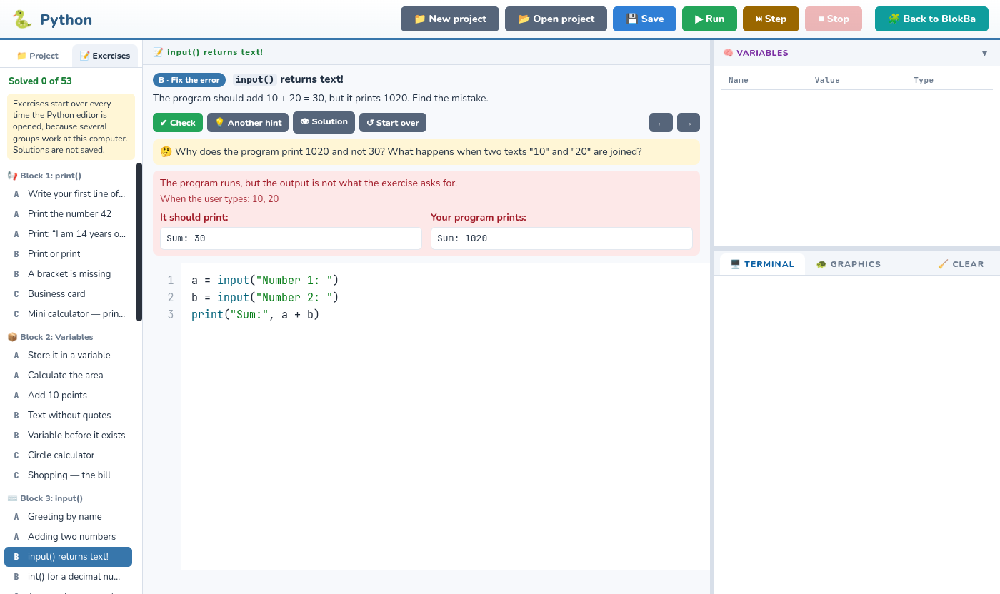

# BlokBa

**From the first block to a real Python program — in one application.**

BlokBa is a free application for teaching programming in primary school.
Students snap blocks together, and the blocks are **translated live into real
Python code** that runs right away. When it is time for text-based
programming, students stay in the same application: same window, same
terminal, same helper — only now they write the code themselves.

Works **completely offline**, on Windows and Linux, including older computers.

> [Bosanski](README.md) · [Hrvatski](README.hr.md) · **English** · [Deutsch](README.de.md)



---

## Download

Latest version: **[BlokBa 2.2.2](../../releases/latest)**

| System | Download | Note |
|---|---|---|
| Windows 10/11 | **[BlokBa-2.2.2-Setup.exe](https://github.com/DinoIsanovic/BlokBa-app/releases/latest/download/BlokBa-2.2.2-Setup.exe)** | Recommended — install once |
| Windows 10/11 | [BlokBa-2.2.2-portable.exe](https://github.com/DinoIsanovic/BlokBa-app/releases/latest/download/BlokBa-2.2.2-portable.exe) | No installation, e.g. from a USB stick |
| Linux (64-bit) | **[BlokBa-2.2.2.AppImage](https://github.com/DinoIsanovic/BlokBa-app/releases/latest/download/BlokBa-2.2.2.AppImage)** | Single file, no installation |
| Linux (Debian/Ubuntu) | [BlokBa_2.2.2_amd64.deb](https://github.com/DinoIsanovic/BlokBa-app/releases/latest/download/BlokBa_2.2.2_amd64.deb) | Standard .deb package |

First-run instructions are [below](#first-run).

---

## From block to code

In most block-based tools a block is a metaphor: a command like `say [Hello]`
has nothing to do with how it's written in a real language. In BlokBa the
block shows **actual Python syntax**:

    ⌨ INPUT WHOLE NUMBER  [x]  = int( input( "enter a number: " ))

```python
x = int(input("enter a number: "))
```

Brackets, quotes and `int()` aren't decoration — that's the code that runs.
So the path to text-based programming takes three steps, without switching
tools:

| Step | What the student does |
|---|---|
| 🧩 **Snapping** | Drags blocks and watches Python code appear next to them, line by line. |
| ✏️ **Typing** | Types an expression into a block field (`x + a`, `n % 2 == 0`) instead of building it from smaller blocks. |
| 🐍 **Writing code** | Writes the whole program in the Python editor. A program built from blocks opens in the editor as code, and code can be turned back into blocks. |

---

## What BlokBa offers

### 🧩 Blocks that are Python
- 11 categories: variables, input and output, math, conditions, loops, text,
  lists, drawing, sound, functions and start
- Python code is built live next to the blocks
- A variable name is written with the pencil right in the block — the
  variable is created automatically
- The condition in IF and WHILE blocks is a real block: pull it out, swap it,
  or type it in



### 🤖 Guided tour
**10 step-by-step lessons** — from the first line printed on screen to loops
and conditions. BoT the robot points to where to click and checks every
step. Each lesson ends with an **independent task**.

### 🐍 Python editor
- Programs are saved as ordinary `.py` files in the student's own folder
- **Each line is checked while typing** — a mistake is marked right away,
  not only when the program runs
- The editor keeps indentation after `if`, `for`, `while` and `def`
- Everything saves automatically, with earlier versions to go back to

### ✅ Python exercises with checking
The exercises are for **writing real Python code**. They are done in the
Python editor: the **🐍 Python** button, then the **📝 Exercises** tab. There
are **53** of them, ordered along the curriculum, and each one checks itself.

| Area | Exercises | What is practised |
|---|:---:|---|
| Block 1: `print()` | 7 | printing text and numbers, combining text and numbers, upper and lower case, brackets |
| Block 2: variables | 7 | storing values, calculating with variables, area, a shopping bill |
| Block 3: `input()` | 6 | keyboard input, `int()` and `float()`, why `input()` returns text |
| Block 4: `if` / `elif` / `else` | 9 | conditions, colon and indentation, `=` vs `==`, guarding against division by zero |
| Block 5: `for` loop | 24 | counting, countdown, sum and product, multiplication table, even numbers, letter by letter, the largest of five numbers |

#### Kinds of exercises

- **Fill the gap** (21 exercises). The program is finished except for one
  or more places marked with underscores (`___`). The student deals only with the new statement; the rest
  of the program serves as an example. E.g. *The 7 times table*,
  *`elif` — three options*.
- **Fix the error** (16 exercises). The program doesn't work or gives the
  wrong result. The mistakes are the ones beginners really make: `Print`
  instead of `print`, a missing colon or indentation, `=` instead of `==`, a
  variable used before it exists, `input()` returning text so that `10 + 20`
  gives `1020`, a sum that is reset to zero on every pass of the loop.
- **Write a program** (15 exercises). There is only a description; the
  student writes the program alone. E.g. *Temperature converter*, *Average of
  three grades*, *Calculator with a division check*, *How many letters a?*, *The
  largest of five*. The wording of the output is the student's own; what is
  checked is that the results are correct.
- **Arrange the lines** (1 exercise). The lines of a correct program are
  shuffled and have no indentation. The student doesn't type, but moves and
  indents the lines — in Python, indentation is part of the program. This
  kind is modelled on two-dimensional Parsons problems.

#### How checking works

- **✔ Check** runs the program with preset inputs — several times with
  different numbers where needed — and compares the output with the
  solution's output.
- When the output is wrong, the student sees which inputs were used and,
  side by side, **what should have been printed** and **what the program
  printed**.
- When the program crashes, the robot explains the error in plain language,
  with the original Python message in small print below it, so the student
  gets used to reading it.
- **💡 Hint** comes in two steps: first a question that points the way, then
  a concrete tip for that exercise.
- The robot's explanation comes with a tip for that particular error in
  that exercise, e.g. what to do when `int()` gets a
  decimal number.
- **👁 Solution** shows the solution, **↺ Start over** resets the exercise,
  and the arrows lead to the previous and next exercise.
- **▶ Run** and **Step** work inside an exercise too, with the variable
  table.
- The exercises exist in every interface language. Besides the task text,
  the code itself is translated: output messages and variable names.
- Exercises start over every time the Python editor is opened, because
  several groups use the same computer.



#### In class

- The areas follow the order of the curriculum, so the exercises of one area
  can be given right after that topic.
- Each exercise is short and self-contained, so it fits into part of a
  lesson.
- An exercise starts and ends in the same window where the program is written
  and run, without switching to another program.
- On the projector, the program from an exercise can be run step by step,
  with the variable table.

### 👀 See what the program does
- **The variable table** updates live while the program runs, with data types
- **Step by step:** the program runs one line at a time, with the current
  line highlighted
- **The turtle** draws on a grid with coordinates; **sound** plays notes
- Input and output go through a terminal, as in real Python

### 💬 Help when the program crashes
The robot assistant translates Python errors into plain language: what
happened, on which line, and how to fix it. It also recognises infinite
loops. Works **without internet** and without any setup. Optionally, a real
AI helper can be switched on — see [BoT with an AI model](#bot-with-an-ai-model).

### 🌍 Languages
Interface in **Bosnian** (Latin and Cyrillic), **Croatian**, **English** and
**German**. The guided tour and exercises are translated.

---

## Using BlokBa in class

**Classrooms without internet, and old computers.** BlokBa needs nothing from
the network. The Windows version carries its own Python, so school computers
need nothing installed apart from the application itself.

**One tool from grade 6 to grade 9.** Students start with blocks, move on to
typing expressions into block fields, then to the Python editor. The
environment stays the same, so no time is spent learning a new program.

**On the projector.** Code next to the blocks, step-by-step execution and the
variable table show what happens inside a program as it runs — what the
computer does on each line and how values change.

**Independent work.** The guided tour introduces the application without the
teacher explaining every click. Exercises check themselves and the robot
explains errors, which leaves the teacher free for the students who really
need help.

**Every student in their own folder.** Open and save dialogs start in
`Documents`, where students keep their own folders (e.g. `6aG1`, `6aG2`).
Programs stay there.

**Working at home.** The application is free and works the same at home as
at school. A program can be exported as a `.py` file and opened in any Python
environment.

---

## First run

### Windows

On first launch Windows may show a blue window: **"Windows protected your
PC"**. This is not a virus — the message appears for every program that isn't
digitally signed. Click **More info**, then **Run anyway**.

Python is **not required** — it is bundled with the program. If Python is
already installed on the computer, BlokBa uses that one.

### Linux

The AppImage needs permission to run: right-click → *Properties* →
*Permissions* → *Is executable*, or in a terminal:

```bash
chmod +x BlokBa-2.2.2.AppImage
./BlokBa-2.2.2.AppImage
```

On Debian and Ubuntu you can install the `.deb` package instead:

```bash
sudo dpkg -i BlokBa_2.2.2_amd64.deb
```

**Python 3.10 or newer** is required. Most distributions already have it; if
not, BlokBa says so and prints the install command.

---

## BoT with an AI model

On top of the help that always works offline, BoT can be connected to a real
language model, so students can ask in their own words — both with blocks and
in the Python editor. BoT sees the student's program and knows which blocks
exist, but **does not solve the task for the student**: it guides with
questions, step by step.

| Service | Required |
|---|---|
| Anthropic (Claude) | API key, internet |
| OpenAI (GPT) | API key, internet |
| Google (Gemini) | API key, internet |
| **Ollama** | locally installed model, **no internet** |

Set it up in the menu **AI Assistant → Set API key**. The key stays on that
computer only. The AI helper stays **off until you switch it on.**

**Before you turn it on:**
- **Cost.** Anthropic, OpenAI and Google bill usage to your own account;
  Google has a free tier for trying it out.
- **Privacy.** With online services, the questions and the student's code are
  sent to that provider. This deserves a deliberate decision, in line with
  your school's policy. **Ollama keeps everything on the computer.**
- **Ollama needs a capable computer** — several gigabytes of memory, ideally
  on a graphics card. On old classroom machines, the offline help remains.

---

## Bugs and suggestions

<!-- LINK: Discord channel link goes here -->

Please **always include the version number** (*Help → About BlokBa*) and your operating
system. Without it there's no way to tell whether the bug is already fixed.

A screenshot helps more than a description.

---

## Supporting the project

BlokBa is free and will stay free. If you'd like to support further work:

Paypal: nodi_bih@yahoo.de

---

## Terms of use

BlokBa may be **used and shared free of charge in unmodified form**, in schools
and at home.

Modifying, repackaging, or distributing modified versions is not permitted.

---

## Authors

Dino Isanović · Jasmin Suljkanović · Elvir Čajić
