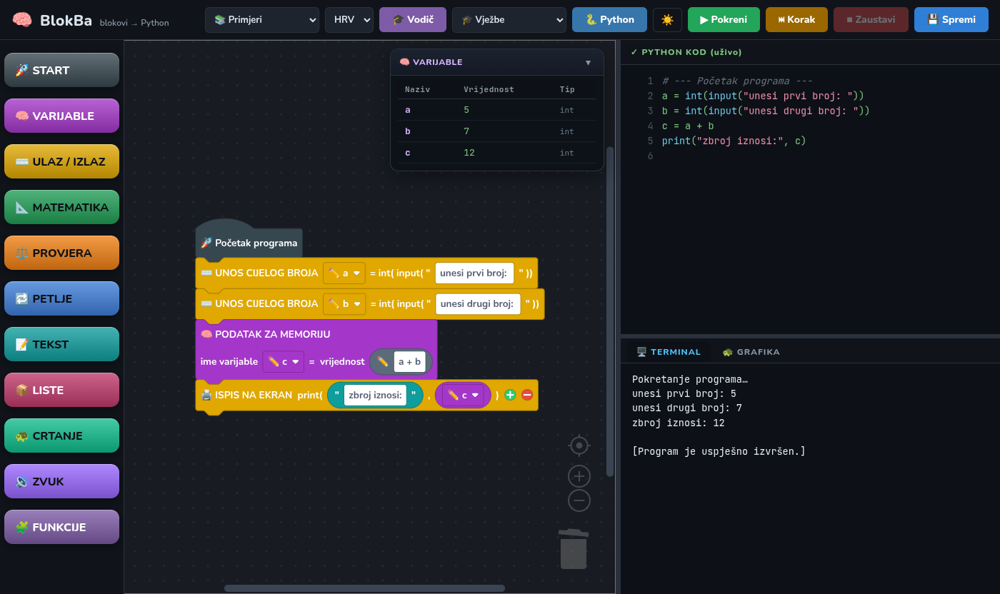
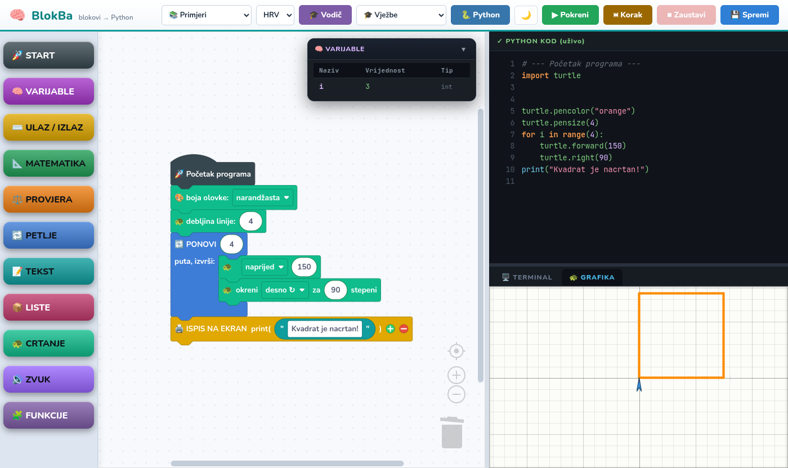
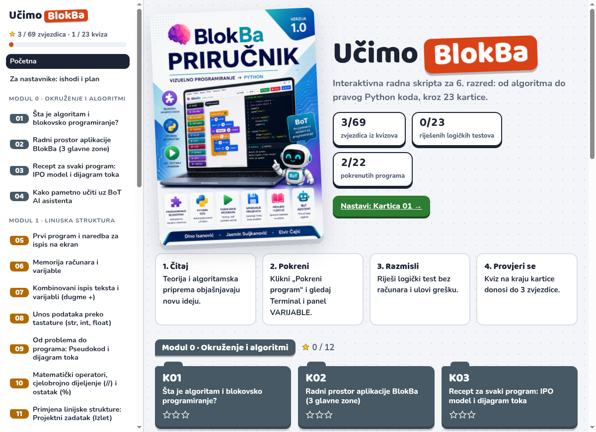
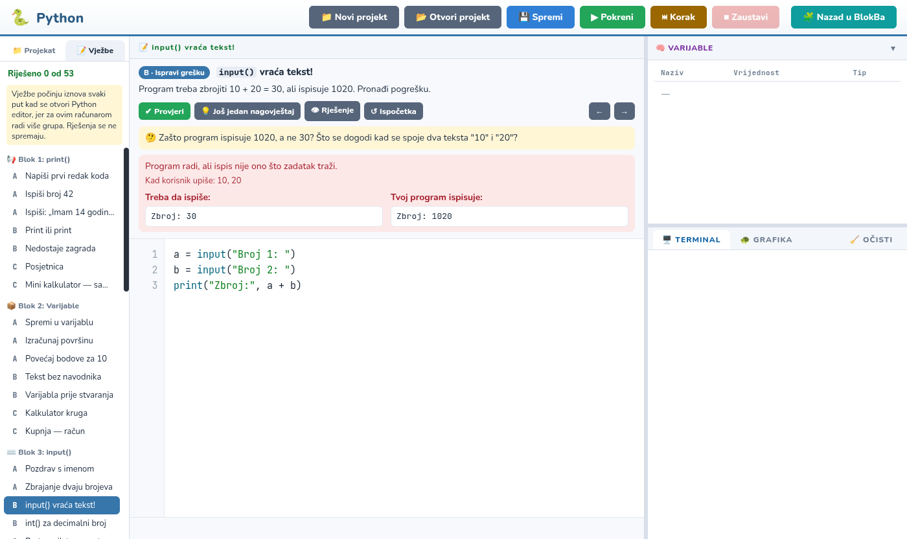

# BlokBa

**Od prvog bloka do pravog Python programa — u jednoj aplikaciji.**

BlokBa je besplatna aplikacija za nastavu programiranja u osnovnoj školi.
Učenici slažu blokove, a blokovi se **uživo prevode u pravi Python kod** koji
se odmah izvršava. Kad dođe vrijeme za tekstualno programiranje, učenici
ostaju u istoj aplikaciji: isti prozor, isti terminal, isti pomoćnik — samo
što sada kod pišu sami.

Radi **potpuno bez interneta**, na Windowsu i Linuxu, i na starijim
računalima.

> [Bosanski](README.md) · **Hrvatski** · [English](README.en.md) · [Deutsch](README.de.md)



---

## Preuzimanje

Najnovija verzija: **[BlokBa 2.2.2](../../releases/latest)**

| Sustav | Preuzimanje | Napomena |
|---|---|---|
| Windows 10/11 | **[BlokBa-2.2.2-Setup.exe](https://github.com/DinoIsanovic/BlokBa-app/releases/latest/download/BlokBa-2.2.2-Setup.exe)** | Preporučeno — instalira se jednom |
| Windows 10/11 | [BlokBa-2.2.2-portable.exe](https://github.com/DinoIsanovic/BlokBa-app/releases/latest/download/BlokBa-2.2.2-portable.exe) | Bez instalacije, npr. s USB-a |
| Linux (64-bit) | **[BlokBa-2.2.2.AppImage](https://github.com/DinoIsanovic/BlokBa-app/releases/latest/download/BlokBa-2.2.2.AppImage)** | Jedna datoteka, bez instalacije |
| Linux (Debian/Ubuntu) | [BlokBa_2.2.2_amd64.deb](https://github.com/DinoIsanovic/BlokBa-app/releases/latest/download/BlokBa_2.2.2_amd64.deb) | Standardni .deb paket |

Upute za prvo pokretanje su [niže](#prvo-pokretanje).

---

## Od bloka do koda

U većini blokovskih alata blok je metafora: naredba tipa `reci [Bok]` nema
veze s time kako se to piše u pravom jeziku. U BlokBa blok pokazuje
**stvarnu Python sintaksu**:

    ⌨ UNOS CIJELOG BROJA  [x]  = int( input( "unesi broj: " ))

```python
x = int(input("unesi broj: "))
```

Zagrade, navodnici i `int()` nisu ukras — to je kod koji se izvršava. Zato
put do tekstualnog programiranja ide u tri koraka, bez promjene alata:

| Korak | Što učenik radi |
|---|---|
| 🧩 **Slaganje** | Povlači blokove i gleda kako uz njih nastaje Python kod, redak po redak. |
| ✏️ **Upisivanje** | U polje bloka tipkovnicom upisuje izraz (`x + a`, `broj % 2 == 0`) umjesto da ga slaže iz manjih blokova. |
| 🐍 **Pisanje koda** | U Python editoru sam piše cijeli program. Program napravljen od blokova otvara se u editoru kao kod, a kod se može vratiti u blokove. |

---

## Što BlokBa nudi

### 🧩 Blokovi koji su Python
- 11 kategorija: varijable, ulaz i izlaz, matematika, provjera, petlje,
  tekst, liste, crtanje, zvuk, funkcije i start
- Python kod nastaje uživo pored blokova
- Ime varijable upiše se olovkom izravno u blok — varijabla se napravi sama
- Uvjet u bloku AKO i DOK pravi je blok: izvuče se, zamijeni ili upiše



### 🤖 Vodič kroz aplikaciju
**10 lekcija** korak po korak — od prvog ispisa na zaslon do petlji i
uvjeta. Robotić BoT pokazuje gdje treba kliknuti i provjerava svaki korak. Na
kraju lekcije učenik dobiva **samostalni zadatak**.

### 📘 Skripta „Učimo BlokBa"
Interaktivna radna skripta za 6. razred — **23 kartice**, od algoritma do
pravog Python koda, s kvizovima i logičkim testovima. Otvara se iz izbornika
**Pomoć → Učimo BlokBa — skripta** u pregledniku i radi bez interneta.



### 🐍 Python editor
- Programi se spremaju kao obične `.py` datoteke u učenikovoj mapi
- **Redak se provjerava dok se tipka** — pogreška se označi odmah, ne tek pri
  pokretanju
- Editor sam drži uvlaku nakon `if`, `for`, `while` i `def`
- Sve se sprema samo, uz ranije verzije za povratak

### ✅ Python vježbe s provjerom
Vježbe su za **pisanje pravog Python koda**. Rješavaju se u Python editoru:
gumb **🐍 Python**, pa kartica **📝 Vježbe**. Ima ih **53**, poredane su
redom gradiva, a svaka se sama provjerava.

| Područje | Vježbi | Što se vježba |
|---|:---:|---|
| Blok 1: `print()` | 7 | ispis teksta i brojeva, spajanje teksta i broja, velika i mala slova, zagrade |
| Blok 2: varijable | 7 | spremanje vrijednosti, računanje s varijablama, površina, račun u trgovini |
| Blok 3: `input()` | 6 | unos s tipkovnice, `int()` i `float()`, zašto `input()` vraća tekst |
| Blok 4: `if` / `elif` / `else` | 9 | uvjeti, dvotočka i uvlaka, `=` i `==`, zaštita od dijeljenja nulom |
| Blok 5: `for` petlja | 24 | brojanje, odbrojavanje, zbroj i umnožak, tablica množenja, parni brojevi, slovo po slovo, najveći od pet brojeva |

#### Vrste vježbi

- **Dopuni prazninu** (21 vježba). Program je gotov, osim jednog ili više
  mjesta označenih crticama (`___`). Učenik se bavi samo novom naredbom, a
  ostatak programa služi mu kao primjer. Npr. *Tablica množenja sa 7*, *`elif` — tri
  mogućnosti*.
- **Ispravi pogrešku** (16 vježbi). Program ne radi ili radi pogrešno.
  Pogreške su one koje početnici stvarno rade: `Print` umjesto `print`,
  zaboravljena dvotočka ili uvlaka, `=` umjesto `==`, varijabla upotrijebljena
  prije nego što je stvorena, `input()` koji vraća tekst pa `10 + 20` daje
  `1020`, zbroj koji se u petlji svaki put vrati na nulu.
- **Napiši program** (15 vježbi). Postoji samo opis zadatka, program učenik
  piše sam. Npr. *Pretvornik temperature*, *Prosjek triju ocjena*, *Kalkulator s
  provjerom dijeljenja*, *Koliko ima slova a?*, *Najveći od pet*. Tekst
  ispisa je učenikov; provjerava se jesu li rezultati točni.
- **Složi retke** (1 vježba). Retci ispravnog programa su izmiješani i bez
  uvlake. Učenik ne tipka, nego retke pomiče i uvlači, jer je u Pythonu i
  uvlaka dio programa. Vrsta je po uzoru na dvodimenzionalne Parsonsove
  zadatke.

#### Kako izgleda provjera

- **✔ Provjeri** pokreće program s unaprijed zadanim ulazima, po potrebi i
  više puta s različitim brojevima, i uspoređuje ispis s ispisom rješenja.
- Kad ispis nije dobar, učenik vidi s kojim je ulazima program pokrenut, a
  jedno pokraj drugoga **što je trebalo ispisati** i **što je program
  ispisao**.
- Kad se program sruši, robot objašnjava pogrešku jednostavnim jezikom, a
  ispod sitno stoji izvorna Python poruka, da se učenik navikava čitati je.
- **💡 Nagovještaj** ima dva koraka: najprije pitanje koje navodi na trag, pa
  konkretan savjet za tu vježbu.
- Uz robotovo objašnjenje stoji i savjet za baš tu pogrešku u toj vježbi,
  npr. što učiniti kad `int()` dobije decimalni broj.
- **👁 Rješenje** pokazuje rješenje, **↺ Ispočetka** vraća vježbu na početak,
  a strelice vode na prethodnu i sljedeću vježbu.
- **▶ Pokreni** i **Korak** rade i u vježbi, uz tablicu varijabli.
- Vježbe postoje na svim jezicima sučelja. Uz tekst zadatka preveden je i sam
  kod: poruke u ispisu i imena varijabli.
- Vježbe počinju ispočetka svaki put kad se otvori Python editor, jer za
  istim računalom radi više grupa.



#### Na nastavi

- Područja prate redoslijed gradiva, pa se vježbe jednog područja mogu dati
  odmah nakon te teme.
- Svaka vježba je kratka i samostalna, pa se može riješiti i u dijelu sata.
- Vježba počinje i završava u istom prozoru u kojem se program piše i
  pokreće, bez prelaska u drugi program.
- Na projektoru se program iz vježbe može izvršavati korak po korak, uz
  tablicu varijabli.

### 👀 Vidi se što program radi
- **Tablica varijabli** mijenja se uživo dok program radi, s tipom podatka
- **Korak po korak:** program se izvršava redak po redak, a trenutni redak je
  istaknut
- **Kornjača** crta na mreži s koordinatama; **zvuk** svira note
- Ulaz i izlaz idu kroz terminal, kao u pravom Pythonu

### 💬 Pomoć kad program pukne
Robot-asistent prevodi Python pogrešku na jednostavan jezik: što se dogodilo,
u kojem retku i kako se popravlja. Prepoznaje i beskonačnu petlju. Radi **bez
interneta** i bez ikakvog podešavanja. Po želji se može uključiti i pravi AI
pomoćnik — vidi [BoT s AI modelom](#bot-s-ai-modelom).

### 🌍 Jezici
Sučelje na **bosanskom** (latinica i ćirilica), **hrvatskom**, **engleskom** i
**njemačkom**. Vodič i vježbe su prevedeni.

---

## Primjena u nastavi

**Učionica bez interneta i stara računala.** BlokBa ništa ne traži s mreže.
Windows verzija nosi svoj Python, pa na školskim računalima ne treba ništa
instalirati osim same aplikacije.

**Jedan alat od prvog bloka do pisanja koda.** Učenici počinju blokovima,
prelaze na upisivanje izraza u polje bloka, pa na Python editor. Okruženje se
ne mijenja, pa se vrijeme ne troši na upoznavanje novog programa.

**Prikaz na projektoru.** Kod pored blokova, korak po korak i tablica
varijabli pokazuju što se događa unutar programa dok se izvršava — što
računalo radi u svakom retku i kako se mijenjaju vrijednosti.

**Samostalan rad.** Vodič uvodi u aplikaciju bez učiteljeva objašnjavanja
svakog klika. Vježbe se same provjeravaju, a robot objašnjava pogrešku, pa
učitelj ostaje slobodan za učenike kojima pomoć zaista treba.

**Svaki učenik u svojoj mapi.** Dijalozi za otvaranje i spremanje polaze od
`Documents`, gdje učenici imaju svoje mape (npr. `6aG1`, `6aG2`). Programi
ostaju ondje.

**Rad kod kuće.** Aplikacija je besplatna i radi isto kod kuće kao u školi.
Program se izvozi kao `.py` datoteka i otvara u svakom Python okruženju.

---

## Prvo pokretanje

### Windows

Pri prvom pokretanju Windows može prikazati plavi prozor **„Windows je
zaštitio vaše računalo"**. To nije virus — poruka se javlja kod svakog
programa koji nije digitalno potpisan. Klikni **More info** (Više
informacija), pa **Run anyway** (Ipak pokreni).

Python **nije potreban** — zapakiran je u program. Ako je na računalu već
instaliran Python, BlokBa koristi njega.

### Linux

AppImage treba dozvolu za izvršavanje: desni klik → *Properties* →
*Permissions* → *Is executable*, ili u terminalu:

```bash
chmod +x BlokBa-2.2.2.AppImage
./BlokBa-2.2.2.AppImage
```

Na Debianu i Ubuntuu može se instalirati i `.deb` paket:

```bash
sudo dpkg -i BlokBa_2.2.2_amd64.deb
```

Potreban je **Python 3.10 ili noviji**. Većina distribucija ga već ima; ako
ga nema, BlokBa to javi i ispiše naredbu za instalaciju.

---

## BoT s AI modelom

Osim pomoći koja uvijek radi bez interneta, BoT se može povezati s pravim
jezičnim modelom, pa učenik može pitati vlastitim riječima — i u blokovima i
u Python editoru. BoT vidi učenikov program i zna koji blokovi postoje, ali
**ne rješava zadatak umjesto učenika**: vodi ga pitanjima, korak po korak.

| Servis | Potrebno |
|---|---|
| Anthropic (Claude) | API ključ, internet |
| OpenAI (GPT) | API ključ, internet |
| Google (Gemini) | API ključ, internet |
| **Ollama** | lokalno instaliran model, **bez interneta** |

Podešava se u izborniku **AI Asistent → Postavi API ključ**. Ključ ostaje
samo na tom računalu. AI pomoćnik je **isključen dok ga sam ne uključiš.**

**Prije uključivanja treba znati:**
- **Cijena.** Anthropic, OpenAI i Google naplaćuju korištenje na tvoj račun;
  Google ima besplatnu razinu za probu.
- **Privatnost.** Kod mrežnih servisa pitanja i učenikov kod odlaze tom
  servisu. To je odluka koju treba donijeti svjesno, u skladu sa školskim
  pravilima. **Ollama sve drži na računalu.**
- **Ollama traži jače računalo** — nekoliko gigabajta memorije, najbolje na
  grafičkoj kartici. Na starim učioničkim računalima ostaje pomoć bez
  interneta.

---

## Prijava pogrešaka i prijedlozi

<!-- LINK: ovdje ubaci link na Discord kanal -->

Uz prijavu **obavezno navedi broj verzije** (*Pomoć → O programu BlokBa*) i
operacijski sustav. Bez toga se ne može utvrditi je li pogreška već
ispravljena.

Snimka zaslona pomaže više od opisa.

---

## Podrška projektu

BlokBa je i ostaje besplatna. Ako želiš podržati daljnji rad:

Paypal: nodi_bih@yahoo.de

---

## Uvjeti korištenja

BlokBa se smije **besplatno koristiti i dijeliti u neizmijenjenom obliku**, u
školama i kod kuće.

Izmjena, prepakiravanje i distribucija izmijenjenih verzija nisu dopušteni.

---

## Autori

Dino Isanović · Jasmin Suljkanović · Elvir Čajić
