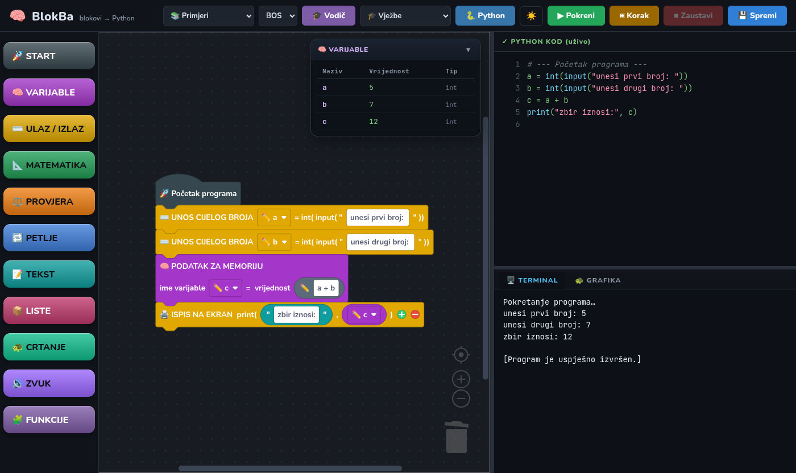
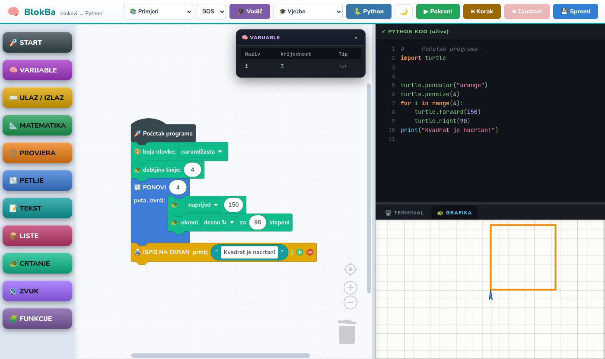
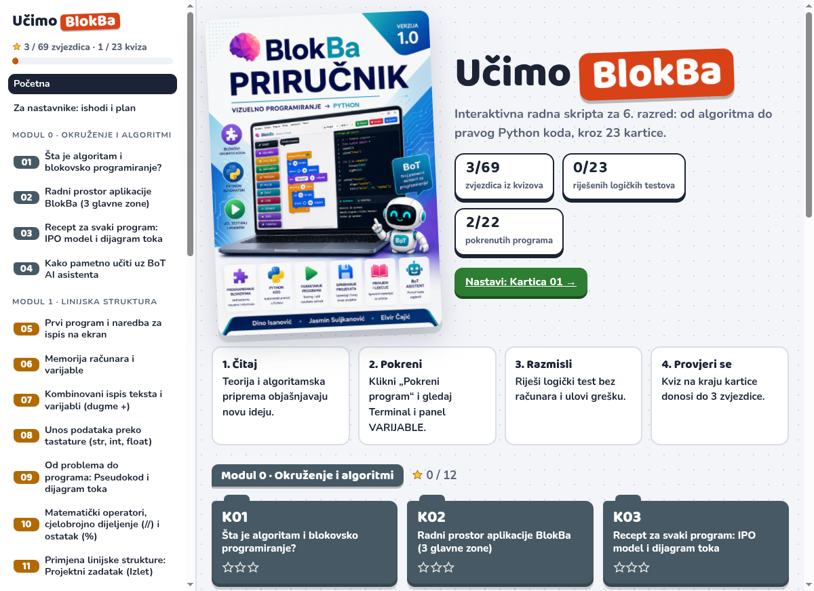
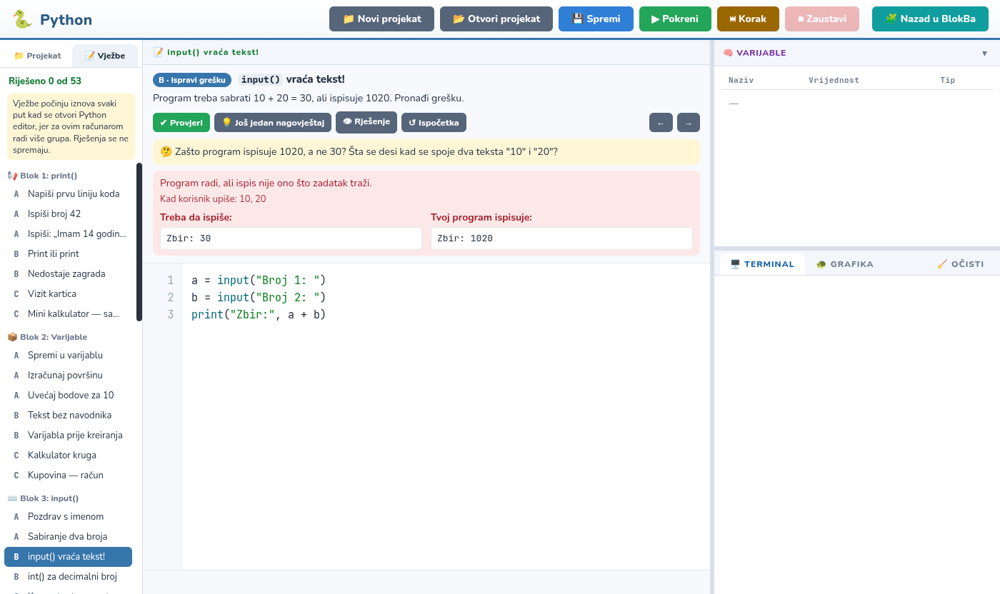

# BlokBa

**Od prvog bloka do pravog Python programa — u jednoj aplikaciji.**

BlokBa je besplatna aplikacija za nastavu programiranja u osnovnoj školi.
Učenici slažu blokove, a blokovi se **uživo prevode u pravi Python kod** koji se
odmah izvršava. Kad dođe vrijeme za tekstualno programiranje, učenici ostaju u
istoj aplikaciji: isti prozor, isti terminal, isti pomoćnik — samo što sada
kod pišu sami.

Radi **potpuno bez interneta**, na Windowsu i Linuxu, i na starijim
računarima.

> **Bosanski** · [Hrvatski](README.hr.md) · [English](README.en.md) · [Deutsch](README.de.md)



---

## Preuzimanje

Najnovija verzija: **[BlokBa 2.2.2](../../releases/latest)**

| Sistem | Preuzimanje | Napomena |
|---|---|---|
| Windows 10/11 | **[BlokBa-2.2.2-Setup.exe](https://github.com/DinoIsanovic/BlokBa-app/releases/latest/download/BlokBa-2.2.2-Setup.exe)** | Preporučeno — instalira se jednom |
| Windows 10/11 | [BlokBa-2.2.2-portable.exe](https://github.com/DinoIsanovic/BlokBa-app/releases/latest/download/BlokBa-2.2.2-portable.exe) | Bez instalacije, npr. sa USB-a |
| Linux (64-bit) | **[BlokBa-2.2.2.AppImage](https://github.com/DinoIsanovic/BlokBa-app/releases/latest/download/BlokBa-2.2.2.AppImage)** | Jedan fajl, bez instalacije |
| Linux (Debian/Ubuntu) | [BlokBa_2.2.2_amd64.deb](https://github.com/DinoIsanovic/BlokBa-app/releases/latest/download/BlokBa_2.2.2_amd64.deb) | Standardni .deb paket |

Upute za prvo pokretanje su [niže](#prvo-pokretanje).

---

## Od bloka do koda

U većini blokovskih alata blok je metafora: naredba tipa `reci [Zdravo]`
nema veze sa tim kako se to piše u pravom jeziku. U BlokBa blok pokazuje
**stvarnu Python sintaksu**:

    ⌨ UNOS CIJELOG BROJA  [x]  = int( input( "unesi broj: " ))

```python
x = int(input("unesi broj: "))
```

Zagrade, navodnici i `int()` nisu ukras — to je kod koji se izvršava. Zato
put do tekstualnog programiranja ide u tri koraka, bez promjene alata:

| Korak | Šta učenik radi |
|---|---|
| 🧩 **Slaganje** | Prevlači blokove i gleda kako uz njih nastaje Python kod, red po red. |
| ✏️ **Upisivanje** | U polje bloka kuca izraz tastaturom (`x + a`, `broj % 2 == 0`) umjesto da ga slaže iz manjih blokova. |
| 🐍 **Pisanje koda** | U Python editoru piše cijeli program sam. Program napravljen od blokova otvara se u editoru kao kod, a kod se može vratiti u blokove. |

---

## Šta BlokBa nudi

### 🧩 Blokovi koji su Python
- 11 kategorija: varijable, ulaz i izlaz, matematika, provjera, petlje,
  tekst, liste, crtanje, zvuk, funkcije i start
- Python kod se gradi uživo pored blokova
- Ime varijable se upiše olovkom direktno u blok — varijabla se napravi sama
- Uslov u bloku AKO i DOK je pravi blok: izvuče se, zamijeni ili upiše



### 🤖 Vodič kroz aplikaciju
**10 lekcija** korak po korak — od prvog ispisa na ekran do petlji i
uslova. Robotić BoT pokazuje gdje se klikne i provjerava svaki korak. Na kraju
lekcije učenik dobija **samostalni zadatak**.

### 📘 Skripta „Učimo BlokBa"
Interaktivna radna skripta za 6. razred — **23 kartice**, od algoritma do
pravog Python koda, sa kvizovima i logičkim testovima. Otvara se iz menija
**Pomoć → Učimo BlokBa — skripta** u pregledniku i radi bez interneta.



### 🐍 Python editor
- Programi se čuvaju kao obični `.py` fajlovi u učenikovoj fascikli
- **Red se provjerava dok se kuca** — greška se označi odmah, ne tek pri
  pokretanju
- Editor sam drži uvlaku poslije `if`, `for`, `while` i `def`
- Sve se sprema samo, uz ranije verzije za povratak

### ✅ Python vježbe sa provjerom
Vježbe su za **pisanje pravog Python koda**. Rade se u Python editoru:
dugme **🐍 Python**, pa kartica **📝 Vježbe**. Ima ih **53**, poredane su
redom gradiva, a svaka se sama provjerava.

| Oblast | Vježbi | Šta se vježba |
|---|:---:|---|
| Blok 1: `print()` | 7 | ispis teksta i brojeva, spajanje teksta i broja, velika i mala slova, zagrade |
| Blok 2: varijable | 7 | spremanje vrijednosti, računanje sa varijablama, površina, račun u prodavnici |
| Blok 3: `input()` | 6 | unos sa tastature, `int()` i `float()`, zašto `input()` vraća tekst |
| Blok 4: `if` / `elif` / `else` | 9 | uslovi, dvotačka i uvlaka, `=` i `==`, zaštita od dijeljenja nulom |
| Blok 5: `for` petlja | 24 | brojanje, odbrojavanje, zbir i proizvod, tablica množenja, parni brojevi, slovo po slovo, najveći od pet brojeva |

#### Vrste vježbi

- **Dopuni prazninu** (21 vježba). Program je gotov, osim jednog ili više
  mjesta označenih crticama (`___`). Učenik se bavi samo novom naredbom, a
  ostatak programa mu služi kao primjer. Npr. *Tablica množenja sa 7*, *`elif` — tri
  mogućnosti*.
- **Ispravi grešku** (16 vježbi). Program ne radi ili radi pogrešno. Greške su
  one koje početnici stvarno prave: `Print` umjesto `print`, zaboravljena
  dvotačka ili uvlaka, `=` umjesto `==`, varijabla upotrijebljena prije nego
  što je napravljena, `input()` koji vraća tekst pa `10 + 20` daje `1020`,
  zbir koji se u petlji svaki put vrati na nulu.
- **Napiši program** (15 vježbi). Postoji samo opis zadatka, program učenik piše
  sam. Npr. *Konvertor temperature*, *Prosjek tri ocjene*, *Kalkulator s
  provjerom dijeljenja*, *Koliko ima slova a?*, *Najveći od pet*. Tekst
  ispisa je učenikov; provjerava se da li su rezultati tačni.
- **Složi redove** (1 vježba). Redovi ispravnog programa su ispremiještani i
  bez uvlake. Učenik ne kuca, nego redove pomjera i uvlači, jer je u Pythonu i
  uvlaka dio programa. Vrsta je po uzoru na dvodimenzionalne Parsonsove
  zadatke.

#### Kako izgleda provjera

- **✔ Provjeri** pokreće program sa unaprijed zadanim ulazima, po potrebi i
  više puta sa različitim brojevima, i poredi ispis sa ispisom rješenja.
- Kad ispis nije dobar, učenik vidi sa kojim ulazima je program pokrenut, a
  jedan pored drugog **šta je trebalo ispisati** i **šta je program
  ispisao**.
- Kad program pukne, robot objašnjava grešku jednostavnim jezikom, a ispod
  sitno stoji originalna Python poruka, da se učenik navikava da je čita.
- **💡 Nagovještaj** ima dva koraka: prvo pitanje koje navodi na trag, pa
  konkretan savjet za tu vježbu.
- Uz robotovo objašnjenje stoji i savjet za baš tu grešku u toj vježbi,
  npr. šta učiniti kad `int()` dobije decimalni broj.
- **👁 Rješenje** pokazuje rješenje, **↺ Ispočetka** vraća vježbu na početak,
  a strelice vode na prethodnu i sljedeću vježbu.
- **▶ Pokreni** i **Korak** rade i u vježbi, uz tabelu varijabli.
- Vježbe postoje na svim jezicima sučelja. Uz tekst zadatka je preveden i
  sam kod: poruke u ispisu i imena varijabli.
- Vježbe počinju ispočetka svaki put kad se otvori Python editor, jer za
  istim računarom radi više grupa.



#### Na času

- Oblasti prate redoslijed gradiva, pa se vježbe jedne oblasti mogu dati
  odmah poslije te teme.
- Svaka vježba je kratka i samostalna, pa se može uraditi i u dijelu časa.
- Vježba počinje i završava se u istom prozoru gdje se program piše i
  pokreće, bez prelaska u drugi program.
- Na projektoru se program iz vježbe može izvršavati korak po korak, uz
  tabelu varijabli.

### 👀 Vidi se šta program radi
- **Tabela varijabli** se mijenja uživo dok program radi, sa tipom podatka
- **Korak po korak:** program se izvršava red po red, a trenutni red je
  osvijetljen
- **Kornjača** crta na mreži sa koordinatama; **zvuk** svira note
- Ulaz i izlaz idu kroz terminal, kao u pravom Pythonu

### 💬 Pomoć kad program pukne
Robot-asistent prevodi Python grešku na jednostavan jezik: šta se desilo, u
kojem redu i kako se popravlja. Prepoznaje i beskonačnu petlju. Radi **bez
interneta** i bez ikakvog podešavanja. Po želji se može uključiti i pravi AI
pomoćnik — vidi [BoT sa AI modelom](#bot-sa-ai-modelom).

### 🌍 Jezici
Sučelje na **bosanskom** (latinica i ćirilica), **hrvatskom**, **engleskom** i
**njemačkom**. Vodič i vježbe su prevedeni.

---

## Primjena u nastavi

**Učionica bez interneta i stari računari.** BlokBa ništa ne traži sa mreže.
Windows verzija nosi svoj Python, pa na školskim računarima ne treba ništa
instalirati osim same aplikacije.

**Jedan alat od VI do IX razreda.** Učenici počinju blokovima, prelaze na
upisivanje izraza u polje bloka, pa na Python editor. Okruženje se ne mijenja,
pa se vrijeme ne troši na upoznavanje novog programa.

**Prikaz na projektoru.** Kod pored blokova, korak po korak i tabela
varijabli pokazuju šta se dešava unutar programa dok se izvršava — šta
računar radi u svakom redu i kako se mijenjaju vrijednosti.

**Samostalan rad.** Vodič uvodi u aplikaciju bez nastavnikovog objašnjavanja
svakog klika. Vježbe se same provjeravaju, a robot objašnjava grešku, pa
nastavnik ostaje slobodan za učenike kojima zaista treba pomoć.

**Svaki učenik u svojoj fascikli.** Dijalozi za otvaranje i spremanje polaze od
`Documents`, gdje učenici imaju svoje fascikle (npr. `6aG1`, `6aG2`). Programi
ostaju tamo.

**Rad kod kuće.** Aplikacija je besplatna i radi isto kod kuće kao u školi.
Program se izvozi kao `.py` fajl i otvara u svakom Python okruženju.

---

## Prvo pokretanje

### Windows

Pri prvom pokretanju Windows može prikazati plavi prozor **„Windows je
zaštitio vaš računar"**. To nije virus — poruka se javlja kod svakog programa
koji nije digitalno potpisan. Klikni **More info** (Više informacija), pa
**Run anyway** (Pokreni svejedno).

Python **nije potreban** — zapakovan je u program. Ako je na računaru već
instaliran Python, BlokBa koristi njega.

### Linux

AppImage treba dozvolu za izvršavanje: desni klik → *Properties* →
*Permissions* → *Is executable*, ili u terminalu:

```bash
chmod +x BlokBa-2.2.2.AppImage
./BlokBa-2.2.2.AppImage
```

Na Debianu i Ubuntuu može se instalirati i `.deb` paket:

```bash
sudo dpkg -i BlokBa_2.2.2_amd64.deb
```

Potreban je **Python 3.10 ili noviji**. Većina distribucija ga već ima; ako
ga nema, BlokBa javi i ispiše komandu za instalaciju.

---

## BoT sa AI modelom

Pored pomoći koja uvijek radi bez interneta, BoT se može povezati sa pravim
jezičkim modelom, pa učenik može pitati vlastitim riječima — i u blokovima i u
Python editoru. BoT vidi učenikov program i zna koji blokovi postoje, ali **ne
rješava zadatak umjesto učenika**: vodi ga pitanjima, korak po korak.

| Servis | Potrebno |
|---|---|
| Anthropic (Claude) | API ključ, internet |
| OpenAI (GPT) | API ključ, internet |
| Google (Gemini) | API ključ, internet |
| **Ollama** | lokalno instaliran model, **bez interneta** |

Podešava se u meniju **AI Asistent → Postavi API ključ**. Ključ ostaje samo na
tom računaru. AI pomoćnik je **isključen dok ga sam ne uključiš.**

**Prije uključivanja treba znati:**
- **Cijena.** Anthropic, OpenAI i Google naplaćuju korištenje na tvoj račun;
  Google ima besplatan nivo za probu.
- **Privatnost.** Kod mrežnih servisa pitanja i učenikov kod odlaze tom servisu.
  To je odluka koju treba donijeti svjesno, uz školsku politiku. **Ollama sve
  drži na računaru.**
- **Ollama traži jači računar** — nekoliko gigabajta memorije, najbolje na
  grafičkoj kartici. Na starim učioničkim mašinama ostaje pomoć bez interneta.

---

## Prijava grešaka i prijedlozi

<!-- LINK: ovdje ubaci link na Discord kanal -->

Uz prijavu **obavezno navedi broj verzije** (*Pomoć → O programu BlokBa*) i operativni
sistem. Bez toga se ne može utvrditi da li je greška već ispravljena.

Screenshot pomaže više od opisa.

---

## Podrška projektu

BlokBa je i ostaje besplatna. Ako želiš podržati dalji rad:

Paypal: nodi_bih@yahoo.de

---

## Uslovi korištenja

BlokBa se smije **besplatno koristiti i dijeliti u neizmijenjenom obliku**, u
školama i kod kuće.

Izmjena, prepakivanje i distribucija izmijenjenih verzija nisu dozvoljeni.

---

## Autori

Dino Isanović · Jasmin Suljkanović · Elvir Čajić
